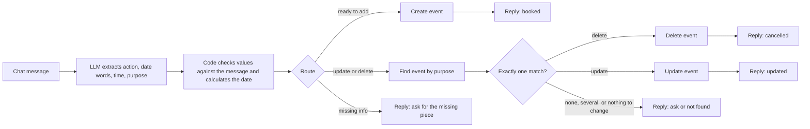

# AI Scheduling Bot (n8n + local LLM)

Books, moves and cancels appointments from plain chat messages. Built with n8n, a local LLM (Ollama, qwen3:4b) and Google Calendar. The scenario is a dental clinic.

**Status:** working prototype, tested on a personal test calendar. It has not been used by any real clinic.

**Demo video:** [add link here]

## The idea behind the design

My first version was an AI agent that chose its own calendar tools. It worked on some runs and failed on others: the small local model often wrote the tool call as plain text instead of running it. In the second version the AI has one narrow job, turning a sentence into four fields (action, date words, time, purpose). Code does everything else: it checks the fields, works out the date and decides what happens.

## How it works

- Every extracted value must appear in the user's own message. If it does not, it is dropped and the bot asks.
- Dates are calculated in code. The model wrote 2023 instead of 2026 even when told today's date.
- An update or delete only runs when exactly one calendar event matches.
- If the model's output does not fit the required format, the bot replies with a polite message instead of failing.

The workflow has 18 nodes: Chat Trigger, Basic LLM Chain, Structured Output Parser, two Code nodes, two Switch nodes, four Google Calendar nodes and six reply nodes.

## Versions

| Version | Design | Outcome |
|---|---|---|
| v1 | n8n AI Agent with 3 Google Calendar tools | Each action worked at least once, but tool calling was unreliable |
| v2 | Extract with the LLM, decide in code | Add, update and delete verified on a real calendar |
| v2.1 | v2 plus three fixes found by offline testing | Included in this repo. Needs a re-run in n8n |

## Test results

**Round 1 (v2, before fixes, 20 messages):** 15 passed, 4 failed, 1 not scored.

| Failure | Cause | Confidence |
|---|---|---|
| `yo book me a root canal tmr 10am` asked for the day | The code did not understand `tmr` | High |
| `cancel my root canal pls` not found | Result of the failure above: it was never booked | High |
| `move my cleaning to oct 20` not found | Probably date words ended up in the purpose, so no event title matched | Medium, not verified |
| `whats the key prompt for this usage` booked "project review" | The model invented a booking and the check against the user's message was probably not in place yet | Medium to high |

**Offline code review (19 mocked cases):** found two more problems. The time check could accept a wrong hour when the same number appears in the date, and the fallback reply was wrong for cancel requests with no purpose. Both are fixed in v2.1. These tests used mocked model output, so they check the code layer only.

**Round 2 (v2.1, 20 messages):** [fill in after re-running on a test calendar]

Full log: [test-log.pdf](test-log.pdf)

## Limitations

- **No confirmation step.** The bot acts as soon as it has all fields.
- **No conflict check on new bookings.** Two patients can be booked at the same time.
- **No memory between messages.** It cannot handle a "which one do you mean?" follow-up unless the user repeats the details.
- **Fixed 30-minute appointments,** including when an appointment is moved.
- **Limited date understanding:** today, tomorrow, weekday names and "Month day". A date that has already passed silently becomes next year.
- **English only,** one timezone (Asia/Ho_Chi_Minh), one calendar. No reminders, patient records or SMS.
- **Only the built-in n8n chat.** It is not connected to a website or messaging app.
- **Matching uses a hand-written list of filler words** that needs upkeep.
- **Tested by one person on fake appointments.** No concurrent users.

## Speed

A message takes roughly 1 to 1.5 minutes on my laptop, which is too slow for live chat.

| Cause | Evidence | Confidence |
|---|---|---|
| Not enough RAM (Ollama, Docker and Chrome together) | Swap was 4.22 GB. The first agent reply took 6 min 7 s. After closing other apps, plain Ollama answered in about 25 to 30 s. | High |
| Agent with several tools | v1 runs took 2 min 55 s to 3 min 39 s | High |
| Long model output for four short fields | About 1,500 to 2,200 tokens per run. Likely hidden reasoning that `/no_think` did not stop. | Medium, not confirmed |
| Everything else | Calendar lookup about 0.65 s, delete about 0.83 s, code under 0.1 s | High |

In one logged run the model step took 58.7 s of a 1 min 0.7 s total, so the model call is about 97% of the wait.

## What I learned

1. Let the AI extract and let code decide. A small model is decent at pulling words out of a sentence and poor at choosing actions.
2. A prompt rule is not a guarantee. "Never guess" was ignored, while a code check against the user's message works.
3. Never trust a small model with dates or with leaving a blank empty.
4. Fail safe: an empty value leads to a question, and a delete needs exactly one match.
5. Check hardware before blaming the model. A 6-minute reply became about 30 seconds after closing other apps.
6. Re-run the whole test suite after every change, including AI-written changes. One update dropped a feature that had been working.
7. Verify on the real calendar. A green checkmark does not prove an event exists.

## What I would improve next

1. Re-run all 20 cases on v2.1 and log the actual reply and run time for each.
2. Add a confirmation step before creating, moving or deleting.
3. Add conversation memory.
4. Check for conflicts before creating an event.
5. Improve the date parser and ask the user when a date has already passed.
6. Reduce latency: shorter prompt, limited output length, keep the model loaded. Change one thing at a time and measure.
7. Keep the original appointment length when moving it.
8. Add Vietnamese.
9. Connect to a real channel such as a website form or Telegram.

## Run it yourself

**You need:** n8n (I run it in Docker), [Ollama](https://ollama.com) with the model pulled (`ollama pull qwen3:4b`), and a Google Calendar OAuth credential in n8n.

1. In n8n, import `scheduling-bot-v2.1.json` as a new workflow.
2. On the **Ollama Model** node, select your Ollama credential and choose `qwen3:4b`.
3. On the four Google Calendar nodes (**Create an event**, **Get many events**, **Update an event**, **Delete an event**), select your credential and a calendar. Use a separate test calendar, because the bot creates, moves and deletes real events.
4. Open the chat panel and try `book a cleaning tomorrow at 3pm`.

The first reply can take a minute or more on a laptop. Close heavy apps while testing.

## About this project

Built by Nguyen Xuan Khoi. I used an AI assistant for guidance and code suggestions. I built and connected the workflow, ran and logged the tests, and found and diagnosed the failures described above, including the wrong-year dates and the invented booking.
